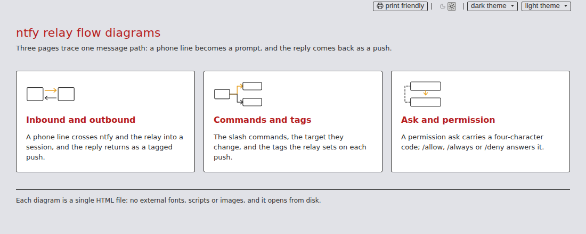

# ntfy-opencode-relay

A self-hosted ntfy relay for OpenCode. It pushes each assistant turn to a phone without Google services, and carries phone replies, commands and files back into the running session.

## What it is

| element | how many | what it does |
|---|---|---|
| phone | one Android app | the F-Droid ntfy client; reads pushes, sends text, files and commands |
| ntfy server | one container | stores messages for 72 h and pushes them to the phone |
| relay | one daemon | the only publisher; reads the phone topic, prompts OpenCode, sends each turn |
| MCP tool | one process per open project | `ntfy-relay.exe mcp`, the `send_file` tool |
| OpenCode | one host | runs the sessions; holds no ntfy token |

Three runtime elements, the phone, the server and the relay, plus the OpenCode host they serve. One topic per project folder carries the traffic. Outbound pushes carry the `oc-out` tag, so the relay ignores them; every other message on the topic is a phone message.

Three binaries ship for each platform:

| binary | runs as | what it does |
|---|---|---|
| `ntfy-relay` | the service, plus one MCP process per project | `run`, `mcp` and `status`; the relay and the MCP server |
| `ntfy-deploy` | one shot | creates or updates the container, and switches the network mode |
| `ntfy-auth` | one shot | creates the `phone` user, the wildcard row and the token file |

The MCP server is part of `ntfy-relay`, so the install has one service binary.

## The boundary

OpenCode never talks to the ntfy server. It has no token and no connection to it. The relay reads the OpenCode event stream over the local API, builds each turn, and is the only process that publishes. OpenCode starts `ntfy-relay.exe mcp` for a project, and the file tool publishes through the same code path. There is no plugin and no second publisher.

## How a message travels

Host to phone: the relay publishes each assistant turn to the topic. The server stores it and pushes it over the phone's own WebSocket.

Phone to host: the phone posts to the same topic. The relay holds one SSE connection, reads the message and posts it to the session as a prompt. Attachments land in `<project>\.ntfy-inbox\`.

Reconnect and restart recover missed assistant text. Message-id dedupe prevents duplicate pushes, and inbound delivery is at-most-once.

## Diagrams

<a href="https://chezhenkie.github.io/ntfy-opencode-relay/"></a>

The [flow pages](https://chezhenkie.github.io/ntfy-opencode-relay/) draw the inbound and outbound routes, the phone commands and tags, and the permission reply.

## Requirements

- A host for the ntfy server: Podman on Windows or Linux, or the native binary on Linux under systemd
- A private network from phone to host, and TLS on 443. The certificate must chain to a public root, because the relay uses the rustls public store; a private CA is not supported
- The F-Droid ntfy client on Android, with no Firebase and no Play services
- OpenCode 2.2.7 or newer

## Install

Start at [docs/index.md](docs/index.md): binaries and checksums, the Windows Podman path, the Ubuntu routes, the private network and the HTTPS switch. The phone side is [docs/phone-app-user-manual.md](docs/phone-app-user-manual.md); network modes are in [docs/switching-networks.md](docs/switching-networks.md).

After the install, check the path:

```powershell
curl.exe -sS https://ntfy.example.ts.net/v1/health
```

From a checkout, the token file and launcher are in `bin\ntfy-relay\` and `relay-windows\`:

```powershell
$token = (Get-Content "$PWD\bin\ntfy-relay\ntfy-token.txt" -Raw).Trim()
curl.exe -sS -H "Authorization: Bearer $token" -H "Title: Test" -d "hello" https://ntfy.example.ts.net/ntfy-proj
powershell.exe -NoProfile -ExecutionPolicy Bypass -File .\relay-windows\start-relay.ps1
powershell.exe -NoProfile -ExecutionPolicy Bypass -File .\tools\startup-check.ps1
```

## Phone commands

Plain text goes to the chat last typed in on the desktop. `/new <title>` creates a session and targets it. `/to` lists five numbered sessions; `/to 2` or a title fragment targets one message. `/auto` drops a pending target. `/sessions` prints numbers and titles. `/status` prints the target and the open asks.

Permission replies are `/allow [code]`, `/always [code]` and `/deny [code]`. A permission ask carries a four-character code and stays answerable until it is answered or evicted.

## Everyday operations

`ntfy-deploy.exe mode` switches between Tailscale, Nord Meshnet and the LAN; the relay keeps running with the same pid and token. `tools\rotate-token.ps1 -User phone` issues a token, writes `ntfy-token.txt`, optionally restarts the relay, then revokes the old token by prefix.

Config, token, state, asks, journal and log live in one relay folder. Only `/v1/health` is anonymous, signup is off, and the server is reachable only from the private network.

## Development

The source is a Rust workspace under `rust\`, with 485 tests. Crates: `core`, `inbound`, `ntfy`, `opencode`, `outbound`, `app`, `deploy` and `auth`. Crate boundaries are in [specsheet 06](docs/specsheet/06-rust-crate-split.md); the build, smoke test and cutover are in [operations 7.9](docs/operations.md#79-rust-daemon-build-smoke-cutover).

Build and test in WSL from `rust\`:

```bash
env PATH=/home/example/.cargo/bin:/usr/local/bin:/usr/bin:/bin \
  CARGO_TARGET_DIR=/home/example/target/ntfy-proj cargo test --workspace
env PATH=/home/example/.cargo/bin:/usr/local/bin:/usr/bin:/bin \
  CARGO_TARGET_DIR=/home/example/target/ntfy-proj cargo build -p ntfy-relay-app -p ntfy-relay-deploy -p ntfy-relay-auth --release --target x86_64-pc-windows-gnu
```

The checks:

```powershell
npm run tlds      # link-safety TLD table matches the IANA source
npm run links     # every relative doc link resolves
npm run secrets   # no tokens, private host names, or real absolute paths
```

CI runs the Node checks and the Rust tests on Ubuntu and Windows.

Protocols:

| surface | where | direction |
|---|---|---|
| REST | ntfy server: `POST /<topic>` to publish, `PUT` for files, `GET /v1/health` | relay to ntfy |
| REST | OpenCode server: `/api/session/<id>/prompt`, `/api/session/<id>/message`, `/api/permission/...` | relay to OpenCode |
| SSE | `GET /api/event` on ntfy, and the OpenCode event stream | long-lived read inside REST |
| MCP | `ntfy-relay mcp` on stdio, one tool `send_file` | OpenCode calls the relay |

REST plus SSE is the data and control plane; MCP is a single-tool interface over the same publish path. See [specsheet 00](docs/specsheet/00-overview.md), [specsheet 02](docs/specsheet/02-message-routes.md) and [specsheet 08](docs/specsheet/08-comms-and-mcp.md).

Repository layout:

```text
rust\                             Rust workspace and the three binaries
container\                        ntfy image: Dockerfile, server.yml, .dockerignore
relay-windows\                    Windows launcher, watchdog, control and deploy examples
tools\                            image build, startup check, token rotation, link and secret scans
docs\                             setup and operations manual, phone manual, specsheet\, flow pages
audit\                            audit rounds and gate evidence, outside the manual
.github\workflows\ci.yml          Node checks and Rust matrix
bin\, resources\, logs\, temp\    local only, gitignored
```

## License

MIT, see `LICENSE`. ntfy itself is Apache-2.0 and is not vendored: the image downloads the published binary and verifies a checksum pinned in the Dockerfile.
